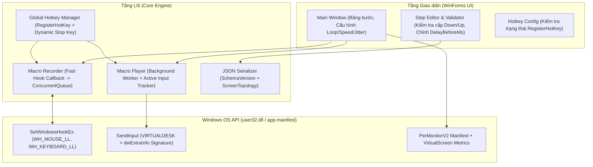

# Kế hoạch R&D & Thiết kế Tool Auto Click (Macro Record & Playback)

## 1. Phân tích Nghiệp vụ & Góc nhìn Người dùng (BA & UX)

Một công cụ **Macro Record & Playback** trên Windows cần giải quyết 4 bài toán thực tế của người dùng:
1. **Thao tác bằng phím tắt toàn cục (Global Hotkeys) an toàn, không xung đột:**
   - Cho phép điều khiển Ghi / Phát / Dừng khi đang ở cửa sổ ứng dụng khác.
   - Tổ hợp phím phải có thể tùy chỉnh, có kiểm tra xung đột khi đăng ký và không chiếm dụng các phím đơn thông dụng (như `ESC` đơn lẻ) của hệ thống khi không cần thiết.
2. **Độ chính xác tọa độ trên môi trường Đa màn hình & DPI khác nhau:**
   - Hỗ trợ ghi nhận **Click chuột** (Trái/Phải/Giữa, Down/Up, Cuộn chuột), **Đường đi chuột** (tùy chọn bật/tắt kèm bộ lọc chống tràn) và **Phím bấm** (tùy chọn).
   - Xử lý chuẩn `PerMonitorV2` DPI Awareness và không gian tọa độ **Virtual Desktop** (bao gồm cả màn hình phụ có tọa độ âm hoặc tỷ lệ scale 125%, 150% khác nhau).
3. **Chỉnh sửa hậu kỳ (Post-editing) chặt chẽ & Tùy biến vòng lặp:**
   - Sau khi quay xong, người dùng có thể xóa bước thừa, sửa thời gian chờ (`DelayBeforeMs`) hoặc tọa độ `(X, Y)`, cấu hình số vòng lặp (`LoopCount`), hệ số tốc độ (`SpeedMultiplier`) và độ trễ ngẫu nhiên (`RandomJitterMs`).
   - Đảm bảo tính toàn vẹn giữa cặp sự kiện `Down` và `Up` khi người dùng thêm/sửa/xóa bước trên bảng chỉnh sửa.
4. **Cơ chế dừng khẩn cấp (Panic / Fail-safe) & Dọn dẹp trạng thái:**
   - Khi hủy giữa chừng, công cụ phải dừng ngay vòng lặp phát và **chỉ nhả đúng các nút chuột/phím mà kịch bản đã tự nhấn giữ** nhưng chưa kịp nhả.

---

## 2. Đánh giá Môi trường & Giới hạn Kỹ thuật (R&D / SA)

### 2.1. Môi trường biên dịch & Runtime
- Máy hiện chưa cài `.NET SDK (dotnet CLI)` và `AutoHotkey`, nhưng có sẵn trình biên dịch C# của Windows: `C:\Windows\Microsoft.NET\Framework64\v4.0.30319\csc.exe`.
- **Quyết định công nghệ:** Sử dụng **C# (.NET Framework 4.8 - WinForms + Win32 Native API)** biên dịch qua `csc.exe`.
- **Lưu ý về phụ thuộc Runtime:** File `.exe` sinh ra là managed assembly chạy trên nền **.NET Framework 4.8** (được tích hợp sẵn trên Windows 10/11 tiêu chuẩn, nhưng vẫn phụ thuộc vào .NET Framework runtime của hệ điều hành chứ không phải native binary độc lập hoàn toàn).

### 2.2. Đặc tính thời gian của `SendInput` và bộ định thời Windows
- [Win32 `SendInput`](https://learn.microsoft.com/en-us/windows/win32/api/winuser/nf-winuser-sendinput) chèn chuỗi sự kiện vào luồng input của hệ thống nhưng **không cam kết thời gian thực (hard real-time)** dưới 1 ms.
- Độ phân giải bộ định thời mặc định của Windows khiến [`Thread.Sleep`](https://learn.microsoft.com/en-us/dotnet/api/system.threading.thread.sleep) / `Task.Delay` có sai số điển hình khoảng ~15.6 ms (1 system tick).
- **Giải pháp điều phối chờ (Pacing Engine):**
  - Sử dụng `Stopwatch` độ phân giải cao làm đồng hồ tham chiếu thực tế.
  - Với khoảng chờ dài (> 20 ms): Ngủ theo lát cắt ngắn (`Thread.Sleep(10)`) có kiểm tra `CancellationToken` liên tục để phản hồi lệnh dừng tức thì.
  - Với phần dư ngắn còn lại ($\le$ 15 ms): Kết hợp `Thread.Sleep(1)` / `Thread.Yield()` đối chiếu với `Stopwatch.ElapsedMilliseconds` để giảm sai số tích lũy mà không gây quá tải CPU.

---

## 3. Thiết kế Kỹ thuật Chi tiết (Technical Design)



### 3.1. Xử lý DPI Đa màn hình (`PerMonitorV2`) & Hệ tọa độ Virtual Desktop
1. **Khai báo DPI Awareness chuẩn:**
   - Nhúng file `app.manifest` vào `.exe` khi biên dịch qua tham số `/win32manifest:app.manifest` của `csc.exe`, khai báo rõ `PerMonitorV2` (và fallback `PerMonitor`):
     ```xml
     <dpiAwareness xmlns="http://schemas.microsoft.com/SMI/2016/WindowsSettings">PerMonitorV2, PerMonitor</dpiAwareness>
     <dpiAware xmlns="http://schemas.microsoft.com/SMI/2005/WindowsSettings">true/pm</dpiAware>
     ```
   - Kết hợp gọi P/Invoke `SetProcessDpiAwarenessContext(DPI_AWARENESS_CONTEXT_PER_MONITOR_AWARE_V2)` tại điểm khởi đầu `Main()` trước khi khởi tạo bất kỳ handle cửa sổ nào.
2. **Lưu trữ & Quy đổi tọa độ trên Virtual Desktop:**
   - Trong `WH_MOUSE_LL`, `MSLLHOOKSTRUCT.pt` trả về tọa độ pixel vật lý trong không gian **Virtual Desktop** (có thể mang giá trị âm nếu màn hình phụ nằm bên trái hoặc phía trên màn hình chính).
   - Khi phát lại bằng [`MOUSEINPUT`](https://learn.microsoft.com/en-us/windows/win32/api/winuser/ns-winuser-mouseinput) trong `SendInput`, sử dụng tổ hợp cờ:
     `MOUSEEVENTF_MOVE | MOUSEEVENTF_ABSOLUTE | MOUSEEVENTF_VIRTUALDESK`
   - Công thức chuẩn hóa tọa độ `(x, y)` sang dải `[0..65535]` trên toàn bộ Virtual Desktop (`GetSystemMetrics` với `SM_XVIRTUALSCREEN`, `SM_YVIRTUALSCREEN`, `SM_CXVIRTUALSCREEN`, `SM_CYVIRTUALSCREEN`):
     $$\text{normalizedX} = \left\lfloor \frac{(x - \text{vLeft}) \times 65536}{\text{vWidth}} \right\rfloor, \quad \text{normalizedY} = \left\lfloor \frac{(y - \text{vTop}) \times 65536}{\text{vHeight}} \right\rfloor$$
3. **Kiểm tra thay đổi cấu hình màn hình (`ScreenTopology`):**
   - Khi ghi kịch bản, lưu kèm thông tin `ScreenTopology` (`VirtualLeft`, `VirtualTop`, `VirtualWidth`, `VirtualHeight`, số lượng màn hình).
   - Lắng nghe sự kiện `SystemEvents.DisplaySettingsChanged` và kiểm tra trước khi bấm `Play`: nếu kích thước/tọa độ `VirtualScreen` hiện tại khác với lúc ghi trong file JSON, hiển thị hộp thoại cảnh báo rõ cho người dùng trước khi chạy.

### 3.2. Thiết kế Phím tắt (Hotkeys), Cơ chế Dừng & Quản lý Low-Level Hook
1. **Không chiếm phím `ESC` đơn lẻ toàn cục:**
   - Mặc định sử dụng tổ hợp phím có modifier để tránh nuốt phím của ứng dụng khác (và cho phép người dùng đổi trên UI):
     - **Bắt đầu / Dừng Ghi (Record):** `Alt + F8`
     - **Bắt đầu / Dừng Phát (Play):** `Alt + F9`
     - **Dừng khẩn cấp (Panic Stop):** `Ctrl + Esc` (hoặc `Alt + F10` tùy chọn; ngoài ra có thể tùy chọn chỉ đăng ký hotkey dừng trong lúc đang `Recording`/`Playing` và hủy đăng ký ngay khi về `Idle`).
   - **Kiểm tra kết quả [`RegisterHotKey`](https://learn.microsoft.com/en-us/windows/win32/api/winuser/nf-winuser-registerhotkey):** Nếu hàm trả về `false` (do ứng dụng khác đã chiếm tổ hợp phím đó), lấy mã lỗi qua `Marshal.GetLastWin32Error()`, hiển thị cảnh báo trực tiếp trên thanh trạng thái UI và yêu cầu người dùng chọn tổ hợp phím khác.
2. **Theo dõi & Nhả an toàn các phím/nút đang giữ (`finally` block):**
   - `MacroPlayer` duy trì 2 tập trạng thái riêng biệt trong suốt phiên chạy:
     - `HashSet<MouseButton> _pressedMouseButtons`
     - `HashSet<ushort> _pressedVirtualKeys`
   - Mỗi khi `MacroPlayer` gửi lệnh `Down`, nút/phím đó được thêm vào tập hợp; khi gửi lệnh `Up`, nút/phím đó được xóa khỏi tập hợp.
   - Trong khối `finally` của luồng phát (kể cả khi kết thúc bình thường hay bị hủy qua `CancellationToken`), `MacroPlayer` duyệt qua `_pressedMouseButtons` và `_pressedVirtualKeys` để **chỉ gửi lệnh `Up` cho đúng những nút/phím mà chính kịch bản đã nhấn giữ nhưng chưa nhả**. Tuyệt đối không gửi lệnh nhả cho các phím/chuột mà người dùng đang nhấn thực tế bên ngoài.
3. **Tối ưu [`LowLevelMouseProc`](https://learn.microsoft.com/en-us/windows/win32/winmsg/lowlevelmouseproc) & Chống vòng lặp sự kiện (Self-Injection Filter):**
   - **Lọc sự kiện do chính tool phát ra:** Mọi lệnh `SendInput` từ `MacroPlayer` đều gán hằng số định danh `dwExtraInfo = 0x4D4F4131` (`"MOA1"`). Trong hàm callback của Hook, nếu phát hiện `hookStruct.dwExtraInfo == 0x4D4F4131` hoặc cờ `LLMHF_INJECTED` / `LLKHF_INJECTED`, hook lập tức trả về `CallNextHookEx` và bỏ qua, không ghi nhận lại.
   - **Xử lý siêu nhẹ trong Hook Callback:** Callback chỉ đọc thông tin nguyên thủy (`wParam`, `pt.x`, `pt.y`, `mouseData`, `vkCode`, `timestamp`) rồi đẩy (`Enqueue`) vào `ConcurrentQueue<RawInputEvent>` và gọi `CallNextHookEx` ngay lập tức (đảm bảo thời gian thực thi < vài micro-giây, không bao giờ chạm ngưỡng `LowLevelHooksTimeout` của Windows). Một luồng nền nhẹ sẽ rút dữ liệu từ hàng đợi để gộp bước và cập nhật UI.

### 3.3. Ngữ nghĩa Dữ liệu (Data Semantics), Quy tắc Editor & JSON Schema

#### Cấu trúc JSON có `SchemaVersion` và `ScreenTopology`
```json
{
  "SchemaVersion": 1,
  "Name": "Kịch bản thao tác mẫu",
  "LoopCount": 1,
  "SpeedMultiplier": 1.0,
  "RandomJitterMs": 10,
  "ScreenTopology": {
    "VirtualLeft": 0,
    "VirtualTop": 0,
    "VirtualWidth": 1920,
    "VirtualHeight": 1080,
    "MonitorCount": 1
  },
  "Steps": [
    {
      "StepId": 1,
      "ActionType": "LeftClick",
      "X": 640,
      "Y": 480,
      "MouseData": 0,
      "VirtualKeyCode": 0,
      "DelayBeforeMs": 250,
      "HoldDurationMs": 35,
      "PairStepId": null
    }
  ]
}
```

#### Định nghĩa rõ ngữ nghĩa các trường:
1. **`DelayBeforeMs` ($\ge 0$):**
   - Là thời gian chờ (tính bằng ms) **trước khi** thực hiện bước hiện tại (tính từ lúc hoàn thành bước liền trước; đối với bước đầu tiên là thời gian chờ kể từ lúc bắt đầu vòng lặp).
2. **Công thức tính thời gian chờ thực tế (`EffectiveDelayMs`) với `SpeedMultiplier` và `RandomJitterMs`:**
   - Gọi $S = \text{SpeedMultiplier}$ ($S > 0$, ví dụ `0.5` đến `10.0`) và $J = \text{RandomJitterMs}$ ($J \ge 0$).
   - Với mỗi bước (hoặc với `HoldDurationMs`), độ lệch ngẫu nhiên $\delta$ được lấy phân bố đều trong đoạn $[-J, +J]$.
   - Thời gian chờ thực tế luôn được kẹp dưới ở mức `0` để **không bao giờ sinh giá trị âm**:
     $$\text{EffectiveDelayMs} = \max\left(0, \text{round}\left(\frac{\text{DelayBeforeMs}}{S}\right) + \delta\right)$$
3. **Tính toàn vẹn cặp sự kiện `Down` / `Up` trong Recorder & Editor:**
   - **Gộp thao tác Click đơn (Click Coalescing):** Khi ghi, nếu giữa `LeftDown` và `LeftUp` tại cùng vùng tọa độ (sai lệch $\le 3$ px) không có sự kiện khác xen vào và thời gian giữ $\le 300$ ms, Recorder tự động gộp thành 1 bước nguyên tử `LeftClick` (lưu `DelayBeforeMs` của `Down` và `HoldDurationMs` là khoảng cách giữa `Down` và `Up`). Tương tự cho `RightClick`, `MiddleClick`, `KeyPress`. Nhờ đó trên bảng Editor, 1 cú click là 1 dòng duy nhất, người dùng sửa/xóa không bao giờ làm mồ côi sự kiện `Up`.
   - **Liên kết cặp `Down` / `Up` rời (khi kéo thả chuột `Drag & Drop` hoặc giữ phím tổ hợp):**
     - Nếu người dùng giữ chuột di chuyển xa (Drag) hoặc giữ phím kèm thao tác khác, Recorder giữ nguyên cặp bước rời (`LeftDown` ... `MouseMove` ... `LeftUp`) và gán `PairStepId` trỏ chéo nhau giữa bước `Down` và bước `Up`.
     - **Quy tắc khi xóa/sửa trên Editor:**
       - Khi xóa một bước `Down` (hoặc `Up`) có `PairStepId`, Editor tự động hỏi xác nhận để **xóa luôn bước đối ứng** (`Up` / `Down`) nhằm tránh để lại nút bị kẹt.
       - Khi đổi loại hành động (`ActionType`) của một bước có cặp (ví dụ đổi `LeftDown` sang `RightDown`), tự động đồng bộ bước `Up` đối ứng sang `RightUp`.
       - **Bộ kiểm tra trước khi Lưu/Chạy (`MacroValidator`):** Quét tuần tự kịch bản; nếu phát hiện bất kỳ trạng thái `Down` nào bị lặp chồng hoặc không có `Up` đóng lại trước cuối kịch bản, hiển thị dòng lỗi cụ thể và chặn chạy cho tới khi người dùng sửa hoặc chọn tự động chèn bước `Up`.

---

## 4. Cấu trúc Thư mục & Lộ trình Triển khai

### Cấu trúc thư mục (`D:\moveo\codebayba\auto-clicker\`)
```text
D:\moveo\codebayba\auto-clicker\
├── PLAN.md               # Tài liệu R&D và Thiết kế kiến trúc
├── app.manifest          # Khai báo PerMonitorV2 DPI Awareness
├── src\
│   ├── NativeMethods.cs  # Win32 API (SetWindowsHookEx, SendInput, RegisterHotKey, VirtualScreen)
│   ├── Models.cs         # SchemaVersion, ScreenTopology, MacroStep, MacroValidator, JSON IO
│   ├── MacroEngine.cs    # Recorder (Queue + Coalescing) & Player (VirtualDesk + Safe Release)
│   └── MainForm.cs       # Giao diện chính, Step Editor, cấu hình Hotkey & cảnh báo màn hình
├── macros\               # Thư mục lưu các kịch bản .json
├── build.bat             # Script biên dịch bằng csc.exe kèm /win32manifest:app.manifest
└── AutoClicker.exe       # File thực thi (.NET Framework 4.8)
```

### Các giai đoạn thực hiện:
1. **Phase 1 — Manifest, Win32 P/Invoke & Data Model (`app.manifest`, `NativeMethods.cs`, `Models.cs`):**
   - Thiết lập `PerMonitorV2`, hàm quy đổi tọa độ `VirtualDesktop`, cấu trúc JSON có `SchemaVersion: 1`, `ScreenTopology` và `MacroValidator`.
2. **Phase 2 — Core Recorder & Player Engine (`MacroEngine.cs`):**
   - Cài đặt Hook tốc độ cao qua `ConcurrentQueue`, lọc `dwExtraInfo`, tự động gộp `Click` nguyên tử hoặc gắn `PairStepId` cho thao tác kéo thả.
   - Cài đặt `MacroPlayer` với bộ đếm thời gian `Stopwatch`, áp dụng `SpeedMultiplier` + `RandomJitterMs` không âm, và khối `finally` nhả đúng các nút/phím đang giữ.
3. **Phase 3 — Giao diện Editor, Quản lý Hotkey & Build (`MainForm.cs`, `build.bat`):**
   - Giao diện bảng bước đồng bộ cặp `Down`/`Up`, cấu hình và kiểm tra lỗi `RegisterHotKey`, cảnh báo khi `ScreenTopology` thay đổi, biên dịch và kiểm thử.
